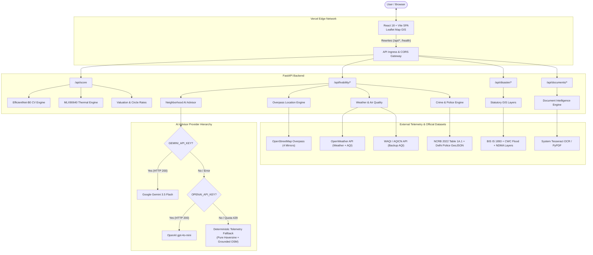

# NIVAS — Unified Property & Neighbourhood Intelligence Platform

[](https://nivas-one.vercel.app)
[](https://github.com/prastogidev/NIVAS)
[](https://github.com/prastogidev/NIVAS)
[](https://github.com/prastogidev/NIVAS)
[](https://www.python.org/)
[](https://react.dev/)
[](https://fastapi.tiangolo.com/)
[](LICENSE)

<p align="center">
  
</p>

> **"Find the place that feels like home — verified by evidence, not speculation."**

NIVAS is a unified property and neighbourhood intelligence platform that bridges the gap between individual physical building inspections and systemic urban-environmental realities.

In traditional real estate evaluations, property condition inspections, municipal civic infrastructure, disaster hazards, crime statistics, legal title due diligence, and valuation are fragmented across disconnected portals, paper deeds, or subjective broker claims. NIVAS unites these disparate dimensions into a single evidence-grounded analytics system — combining physical defect analysis, thermal insulation imaging, live OpenStreetMap civic infrastructure walkability, official statutory disaster zoning, statutory state crime baselines, legal document entity extraction with page-level citations, and an AI-powered conversational neighbourhood advisor.

* **Live Production Platform:** [https://nivas-one.vercel.app](https://nivas-one.vercel.app)
* **GitHub Repository:** [https://github.com/prastogidev/NIVAS](https://github.com/prastogidev/NIVAS)

---

## Key Features

NIVAS is organized into seven state-isolated yet interconnected intelligence domains:

### 1. Livability Intelligence
* **Civic Infrastructure Telemetry:** Concurrently queries a failover pool of 4 public OpenStreetMap Overpass API mirrors (`overpass.openstreetmap.fr`, `overpass-api.de`, `kumi.systems`, `private.coffee`) for 13 essential civic amenity categories: schools, hospitals, clinics, pharmacies, police stations, fire stations, bus terminals, railway/metro stations, and major arterial roads.
* **Geometric Distance Analysis:** Straight-line distances computed via the Haversine great-circle formula with user-configurable search radii (500m to 10,000m).
* **Atmospheric Quality & Meteorological Observation:**
  * Real-time Air Quality Index (AQI) via OpenWeather Air Pollution API (1–5 scale with $\text{PM}_{2.5}$, $\text{PM}_{10}$, $\text{NO}_2$, $\text{SO}_2$, $\text{CO}$, $\text{O}_3$ component breakdown) with automatic fallback to WAQI / AQICN (0–500 CPCB/US-EPA continuous scale) using geographical proximity gating ($\le 50\text{ km}$).
  * Instantaneous meteorological observations (temperature, feels-like, relative humidity, atmospheric pressure, wind speed, wind direction, sky conditions) via OpenWeather Current Weather Data API.
  * Explicit provenance disclosures isolating instantaneous weather observations from statutory disaster risk zoning.

### 2. Safety Intelligence
* **National Statutory Crime Baseline:** Curated dataset grounded in official National Crime Records Bureau (NCRB) *Crime in India 2022* (Volume I, Table 1A.1) covering all 36 States and Union Territories with comparative national benchmark rates (258.1 per 100k population).
* **Delhi Police Operational District Analysis:** Ray-casting point-in-polygon resolution across 15 official Delhi Police district polygons. District totals are clearly disclosed as administrative estimates, and per-capita rates are deliberately suppressed at the district level to prevent census-tract boundary misalignment distortions.
* **Emergency Directory & Station Proximity:** Verified Delhi Police station catalog augmented with live OpenStreetMap emergency infrastructure nodes within the property's immediate vicinity.

### 3. Disaster Intelligence
Multi-hazard spatial risk engine querying 8 official statutory GIS layers:
1. **BIS Seismic Hazard Zoning:** Bureau of Indian Standards (BIS IS 1893:2016) seismic zones (Zone II through Zone V, Nominal Peak Ground Acceleration factors $Z = 0.10$ to $0.36$).
2. **CWC River Flood Basins:** Central Water Commission (CWC) 100-year regional river flood inundation corridors.
3. **NDMA / IMD Cyclone Exposure:** National Disaster Management Authority & India Meteorological Department coastal cyclone hazard classifications.
4. **GSI Landslide Susceptibility:** Geological Survey of India National Landslide Susceptibility Mapping (NLSM) macro-zones.
5. **IMD Heatwave Exposure:** India Meteorological Department climatological heatwave vulnerability zones.
6. **CGWB Groundwater & Water Stress:** Central Ground Water Board basin-level depletion metrics.
7. **Yamuna River Floodplain:** Delhi Master Plan (MPD) statutory flood corridor boundaries.
8. **Delhi PWD Waterlogging Hotspots:** Municipal vulnerability hotspots cataloged by Delhi Public Works Department during monsoon seasons.

### 4. Property Inspection (Computer Vision)
* **Wall Condition Classifier Architecture:** PyTorch transfer learning model built on torchvision **EfficientNet-B0** with ImageNet initialization and a custom classification head.
* **Canonical Defect Classes (5):** `clean`, `damp`, `algae`, `mold`, `broken`.
* **Image Quality & Blur Safeguards:** Discrete 2D Laplacian variance pre-filtering ($\nabla^2 \ge 50.0$) evaluated on a consistently normalized grayscale grid ($\le 512\text{px}$) to avoid penalizing high-resolution inputs.
* **Multi-Image & Video Frame Aggregation:** Evaluates sets of uploaded property photos or extracts video frames at 2-second intervals, averaging valid probability distributions.
* **Checkpoint Status Disclosure:** *Honest disclosure: The EfficientNet-B0 inference pipeline is fully architected and regression-tested, but no genuine fine-tuned checkpoint is currently available. In accordance with zero-fabrication safeguards, the system returns an explicit `model_unavailable` state rather than generating random predictions or unverified confidence scores.*

### 5. Thermal Intelligence
* **Hardware Driver:** Native I2C driver integration for the **Melexis MLX90640** 32 × 24 far-infrared thermal sensor array.
* **Signal Processing & Anomaly Extraction:** 2D spatial median filtering (`scipy.ndimage.median_filter`) over radiometric thermal matrices; pixels deviating $\ge 3.5^\circ\text{C}$ from the local neighborhood median are flagged as insulation voids, thermal bridges, or concealed moisture pockets.
* **Hardware Requirement Disclosure:** *Physical hardware is required for live sensor streaming. When no sensor is attached or no radiometric image is provided, NIVAS returns `sensor_status: "Disconnected (null)"` and `insulation_score: null`, never fabricating synthetic thermal metrics.*

### 6. Property Valuation & Price Intelligence
* **Price Per Square Foot Analytics:** Compares asking rates against Delhi Municipal Corporation (MCD) Sub-Registrar circle rate categories (Category A through Category H, ranging from ₹7,74,000/sqm down to ₹23,280/sqm).
* **Locality Benchmarks:** Verified local benchmark cache covering key Delhi localities (Dwarka, Rohini, Lajpat Nagar) with optional commercial Propstack Valuation API failover.
* **Truthful Data Labeling:** All valuation benchmarks are explicitly distinguished as cached demonstration data versus live commercial valuation feeds.

### 7. Document Intelligence
* **Legal Entity Extraction:** In-memory parsing of real estate contracts (PDF/TXT) extracting Vendor names, Purchaser names, declared financial consideration, earnest deposits, plot/flat schedule descriptions, and Sub-Registrar Office (SRO) registration codes.
* **Page-Level Grounded Evidence:** Every extracted entity is bound to an `EvidenceSnippet` detailing character spans and exact 1-indexed document page numbers.
* **Cross-Document Discrepancy Auditing:** Automated comparative diffing across transaction chains (e.g., Agreement to Sell vs. Sale Deed) flagging conflicting purchase amounts, mismatched parties, or altered plot identifiers.
* **Scanned PDF & OCR Support:** Integrates `pytesseract` to detect image-only scanned pages; gracefully alerts the user if system Tesseract binaries are not installed while preserving native text extraction.
* **Prompt Injection Protection:** Neutralizes prompt-injection attempts and instruction override sequences embedded in document text.

### 8. Neighborhood AI Advisor
* **Generative Model Providers:** Powered by **Google Gemini 3.5 Flash** (`gemini-3.5-flash`) via the Google Gemini API, with secondary fallback support for OpenAI (`gpt-4o-mini`).
* **Factual Grounding:** Generative prompts are strictly constrained to retrieved telemetry (OSM coordinates, CPCB/OpenWeather AQI, BIS seismic factors, NCRB crime baselines). Guardrail output sanitizers filter out fabricated composite scores or speculative safety claims.
* **Deterministic Telemetry Fallback:** If API keys are unconfigured, rate-limited, or quota-exhausted, the system automatically activates a deterministic rule engine (`generate_grounded_telemetry_reply`) calculating exact Haversine distances to verified amenities.
* **Interactive UI:** Available as a floating persistent launcher across all workspaces with interactive suggested inquiries and integrated document attachment analysis.

---

## Architecture



---

## Technology Stack

| Layer | Technologies & Libraries |
| :--- | :--- |
| **Frontend** | React 18.3, Vite 6.4, JavaScript (ES2022), Leaflet 1.9, Lucide React icons, Axios, Vitest |
| **Backend** | Python 3.10 / 3.14, FastAPI 0.141, Starlette, Uvicorn, Pydantic v2 |
| **Data Processing & Signal** | NumPy, SciPy (median filtering), Pillow, OpenCV Headless (blur & video frame extraction) |
| **Document Intelligence** | PyPDF 6.21, pytesseract (OCR integration) |
| **AI & LLM Services** | Google Gemini API (`gemini-3.5-flash`), OpenAI API (`gpt-4o-mini`) |
| **Geospatial & Telemetry** | OpenStreetMap Overpass API, Nominatim Geocoding, OpenWeather API, WAQI / AQICN API |
| **Statutory Data Assets** | NCRB Crime in India 2022 Table 1A.1, BIS IS 1893:2016 GeoJSON, CWC River Flood Basins GeoJSON, Delhi Police District Polygons |
| **Deployment & Hosting** | Vercel Multi-Service Platform (`vercel.json`), GitHub Actions |

---

## Project Structure

```
NIVAS/
├── .gitignore
├── .gitmodules                         # Tracks backend submodule (branch: backend)
├── DEPLOYMENT.md                       # Vercel multi-service deployment documentation
├── README.md                           # This document
├── pytest.ini                          # Root Pytest configuration
├── vercel.json                         # Vercel unified frontend/backend multi-service routing
│
├── frontend/                           # React 18 + Vite SPA client
│   ├── index.html
│   ├── package.json
│   ├── vite.config.js                  # Vite configuration & dev proxy (:8000)
│   ├── public/                         # Public branding and icons
│   │   ├── nivas_logo.png
│   │   └── neighborhood-ai-logo.svg
│   └── src/
│       ├── App.jsx                     # Top-level workspace navigation & state
│       ├── index.css                   # Theme and component styles
│       ├── components/                 # Workspace views & UI modules
│       │   ├── LivabilityWorkspace.jsx
│       │   ├── SafetyIntelligenceWorkspace.jsx
│       │   ├── DisasterIntelligenceWorkspace.jsx
│       │   ├── PropertyInspectionWorkspace.jsx
│       │   ├── DocumentIntelligenceWorkspace.jsx
│       │   ├── NeighborhoodAiAdvisor.jsx
│       │   ├── PropertyLocationPicker.jsx
│       │   └── __tests__/              # 99 Vitest component unit tests
│       └── services/
│           └── api.js                  # Axios client calling same-origin /api endpoints
│
├── backend/                            # FastAPI Serverless Application (Git submodule)
│   ├── main.py                         # Application entrypoint & CORS middleware
│   ├── requirements.txt                # Production serverless runtime dependencies
│   ├── requirements-ml.txt             # Extended training/PyTorch dependencies (local/GPU)
│   ├── api/                            # API Router endpoints
│   │   ├── score.py                    # Composite property scoring & inspection
│   │   ├── livability.py               # Civic infrastructure, weather, AQI, AI advisor chat
│   │   ├── disaster.py                 # Multi-hazard GIS risk queries & comparisons
│   │   └── documents.py                # Document analysis, sample deeds, cross-document diffs
│   ├── core/
│   │   └── config.py                   # Pydantic Settings & environment variable loader
│   ├── models/                         # Pydantic data schemas & contracts
│   │   ├── score.py
│   │   ├── livability.py
│   │   ├── safety.py
│   │   ├── disaster.py
│   │   └── documents.py
│   ├── services/                       # Business logic, algorithmic engines, API clients
│   │   ├── air_quality.py              # OpenWeather & WAQI/AQICN pipeline
│   │   ├── weather.py                  # OpenWeather ambient meteorological conditions
│   │   ├── location.py                 # Overpass infrastructure & Nominatim geocoding
│   │   ├── livability_advisor.py       # Gemini / OpenAI / Grounded Telemetry engine
│   │   ├── crime_data.py               # NCRB 2022 baseline & Delhi Police polygon resolver
│   │   ├── disaster.py                 # BIS, CWC, NDMA spatial layer evaluators
│   │   ├── document_analysis.py        # PDF entity extraction, OCR hook, discrepancy engine
│   │   ├── cv_model.py                 # EfficientNet-B0 inference & blur validation
│   │   ├── thermal.py                  # MLX90640 radiometric spatial median filter
│   │   └── price.py                    # MCD circle rates & benchmark price analytics
│   ├── cv/                             # Computer Vision pipeline architecture
│   │   ├── model.py                    # EfficientNet-B0 PyTorch model builder
│   │   └── train.py                    # Transfer learning training harness & class weighting
│   ├── data/                           # Curated static datasets & official GIS layers
│   │   ├── crime/                      # NCRB Table 1A.1 & Delhi Police boundaries
│   │   ├── disaster/                   # 8 official statutory GeoJSON hazard layers
│   │   └── cached_demo_data/           # Delhi locality benchmarks (Dwarka, Rohini, Lajpat Nagar)
│   └── tests/                          # 192 Pytest backend tests
│
├── cv_pipeline/                        # Dataset curation & candidate promotion utilities
│   ├── ingestion.py                    # Deduplication & dHash image intake
│   ├── label_map.py                    # Canonical defect class mapping
│   ├── dataset_check.py                # Split integrity & leakage auditor
│   ├── field_eval.py                   # Isolated field benchmark evaluator
│   └── promote_candidate.py            # Checkpoint promotion gatekeeper
│
└── data/
    ├── field_eval/                     # 25 isolated human-reviewed field evaluation images
    └── wall_condition_dataset_v2/      # Ingestion logs & attribution metadata
```

---

## Installation & Local Setup

### Prerequisites
* **macOS or Linux** (tested on macOS Sequoia / Ubuntu 22.04 LTS)
* **Python 3.10 to 3.14**
* **Node.js 18+ and npm**
* *(Optional)* `tesseract` binary installed for local scanned PDF OCR (`brew install tesseract` on macOS or `sudo apt-get install tesseract-ocr` on Ubuntu)

### Step 1: Clone the Repository
Clone recursively to include the backend submodule:
```bash
git clone --recurse-submodules https://github.com/prastogidev/NIVAS.git
cd NIVAS
```

### Step 2: Setup Backend Virtual Environment
```bash
cd backend
python3 -m venv venv
source venv/bin/activate
pip install --upgrade pip
pip install -r requirements.txt
```

### Step 3: Configure Environment Variables
Create a local configuration file in `backend/.env`:
```bash
cp .env.example .env
```
*(See the [Environment Variables](#environment-variables) section below for optional keys. NIVAS operates with full deterministic functionality even when third-party API keys are omitted.)*

### Step 4: Start the FastAPI Backend
```bash
# From the backend/ directory with venv activated:
uvicorn main:app --host 127.0.0.1 --port 8000 --reload
```
Verify the health endpoint in your browser: [http://127.0.0.1:8000/health](http://127.0.0.1:8000/health)

### Step 5: Setup & Start Frontend Client
In a new terminal window:
```bash
cd NIVAS/frontend
npm install
npm run dev -- --port 3000
```
Open [http://localhost:3000](http://localhost:3000) to access the NIVAS web interface. The Vite dev server automatically proxies `/api/*` and `/health` requests to `http://127.0.0.1:8000`.

---

## Environment Variables

All third-party credentials must be kept strictly server-side in `backend/.env` (locally) or in the **Vercel Dashboard > Project Settings > Environment Variables** (production). Credentials must never be committed to git or exposed to the frontend browser bundle.

| Variable Name | Required? | Default Fallback if Unset | Purpose |
| :--- | :---: | :--- | :--- |
| `GEMINI_API_KEY` | Optional | Falls back to OpenAI or deterministic telemetry | Google Gemini 3.5 Flash conversational intelligence |
| `GEMINI_MODEL` | Optional | `gemini-3.5-flash` | Gemini model endpoint selector |
| `OPENAI_API_KEY` | Optional | Falls back to deterministic telemetry | Secondary conversational AI provider (`gpt-4o-mini`) |
| `OPENWEATHER_API_KEY`| Optional | Falls back to WAQI for AQI; weather omitted | Ambient weather observations & air pollution data |
| `AQICN_TOKEN` | Optional | Reports `provider_not_configured` | CPCB / US-EPA continuous air quality station data |
| `AQICN_API_KEY` | Optional | Mirrors `AQICN_TOKEN` | Alias for AQICN token |
| `PROPSTACK_API_KEY` | Optional | Delhi MCD circle rate categories & local benchmarks | Commercial valuation benchmark API |
| `VITE_API_BASE_URL` | Optional | `""` (relative paths to same origin) | Frontend API domain override |

Safe `.env.example` template:
```bash
ENVIRONMENT=development
LOG_LEVEL=INFO

# External Intelligence Providers (All Optional with Graceful Fallbacks)
GEMINI_API_KEY=
GEMINI_MODEL=gemini-3.5-flash
OPENAI_API_KEY=
OPENWEATHER_API_KEY=
AQICN_TOKEN=
AQICN_API_KEY=
PROPSTACK_API_KEY=
```

---

## Key API Endpoints

The FastAPI backend exposes structured REST endpoints with OpenAPI specifications available at `/docs`:

### System Diagnostics
* `GET /health`
  * Returns system operational status.
  * Response: `{"status": "ok", "service": "NIVAS Backend API", "version": "1.0.0"}`

### Composite Property Scoring & Inspection
* `POST /api/score`
  * Request payload:
    ```json
    {
      "address": "Dwarka Sector 10, New Delhi",
      "property_type": "apartment",
      "asking_price": 8500000,
      "built_up_area_sqft": 1200,
      "image_info": { "image_base64": "data:image/jpeg;base64,..." }
    }
    ```
  * Returns composite score (0–100), location walkability metrics, valuation benchmarks, thermal insulation status, and honest CV defect availability.

### Livability & Civic Telemetry
* `GET /api/livability/location-data?latitude=28.5921&longitude=77.0460&radius=1200`
  * Concurrently retrieves verified OpenStreetMap civic infrastructure, OpenWeather ambient meteorological observation, and real-time AQI.
* `POST /api/livability/chat`
  * Conversational query to the Neighborhood AI Advisor grounded in location context.
  * Request: `{"query": "What hospitals are nearby?", "latitude": 28.5921, "longitude": 77.0460}`
  * Response: Returns `reply`, `sources`, `provider_name`, and `is_ai_generated` boolean.

### Safety & Crime Intelligence
* `GET /api/livability/national-safety-overview`
  * Returns India-wide NCRB 2022 Table 1A.1 state/UT safety choropleth GeoJSON with national benchmark (258.1 per 100k).
* `GET /api/livability/safety-data?latitude=28.5921&longitude=77.0460`
  * Resolves Delhi Police operational district, derived administrative incident totals, and nearest police stations directory.

### Disaster & Hazard Risk
* `GET /api/disaster/hazard-data?latitude=28.5921&longitude=77.0460`
  * Evaluates property coordinates across BIS seismic zones, CWC river flood basins, cyclone exposure, and Delhi waterlogging hotspots.
* `POST /api/disaster/compare`
  * Side-by-side comparative hazard risk assessment between two candidate property locations.

### Document Intelligence
* `GET /api/documents/sample-documents`
  * Returns pre-loaded synthetic demonstration property instruments (Agreement to Sell, Consistent Sale Deed, Conflicting Draft) with legal provenance notices.
* `POST /api/documents/analyze` *(multipart/form-data)*
  * Accepts PDF/TXT property instruments; extracts legal entities, consideration, plot schedule, and page-level evidence snippets.
* `POST /api/documents/compare`
  * Performs cross-document audit on extracted document structures, highlighting transaction discrepancies.

---

## Quality Assurance & Testing

NIVAS enforces rigorous test coverage across both the backend Python service and frontend React client. All tests execute hermetically without requiring active third-party API credentials.

```bash
# 1. Run Complete Backend Test Suite (192 Tests)
source backend/venv/bin/activate
pytest backend/tests/ -q --tb=short

# Output: 192 passed, 1 warning in ~22s

# 2. Run Complete Frontend Test Suite (99 Tests)
cd frontend
npm test -- --run

# Output: 7 test files passed, 99 passed in ~2.2s

# 3. Verify Production Frontend Build
npm run build

# Output: Vite production build completed cleanly in <1s (frontend/dist/)
```

### Verified Test Breakdown
* **`test_weather_service.py` (3 tests):** Validates OpenWeather current weather parsing, missing-key disclosures, and rate-limit handling.
* **`test_air_quality_relevance.py` (2 tests):** Enforces WAQI $\le 50\text{ km}$ proximity gate and demo token rejection.
* **`test_document_intelligence.py` (15 tests):** Validates in-memory PDF extraction, scanned PDF OCR detection, page citation alignment, and prompt injection neutralization.
* **`test_livability_advisor.py` (21 tests):** Validates Gemini 3.5 Flash prompt formatting, OpenAI 429 quota exhaustion fallback, and deterministic Haversine rule generation.
* **`test_disaster.py` (16 tests):** Validates statutory BIS seismic zoning, CWC river flood basin intersections, and out-of-coverage boundary guards.
* **`test_safety_crime.py` (16 tests):** Validates NCRB 2022 Table 1A.1 national baseline, Delhi Police district point-in-polygon matching, and rate suppression.
* **`test_cv_patches_p1_p2_p3.py` (30 tests):** Verifies that missing checkpoints return `None` (P1), blur is evaluated on $\le 512\text{px}$ scaled grids (P2), and canonical class ordering `["clean", "damp", "algae", "mold", "broken"]` is strictly preserved (P3).
* **Multi-Image & Video CV Tests (11 tests):** Validates frame sampling, blur rejection, and probability averaging.
* **Frontend Vitest Suite (99 tests):** Validates all 5 workspaces, responsive controls, interactive prompt chips, Leaflet GIS rendering, and error states.

---

## Production Deployment

NIVAS is deployed as a unified multi-service project on the **Vercel Edge Network**:

* **Live Production URL:** [https://nivas-one.vercel.app](https://nivas-one.vercel.app)
* **Production Deployment Architecture:** Configured via root [`vercel.json`](vercel.json):
  ```json
  {
    "services": {
      "frontend": { "root": "frontend/", "framework": "vite", "outputDirectory": "dist" },
      "backend": { "root": "backend/", "framework": "fastapi", "entrypoint": "main:app" }
    },
    "rewrites": [
      { "source": "/api/(.*)", "destination": { "service": "backend" } },
      { "source": "/health", "destination": { "service": "backend" } },
      { "source": "/(.*)", "destination": { "service": "frontend" } }
    ]
  }
  ```
* **Unified Same-Origin Routing:** Client calls route directly to `/api/*` and `/health` on the same origin without CORS preflight overhead or domain switching.
* **Serverless Environment Configuration:** Configured securely in Vercel project settings (`GEMINI_API_KEY`, `GEMINI_MODEL`, `OPENWEATHER_API_KEY`, `AQICN_TOKEN`, `AQICN_API_KEY`, `OPENAI_API_KEY`).

---

## Current Limitations & Engineering Disclosures

In commitment to scientific and technical honesty, NIVAS explicitly documents the following operational boundaries:

1. **Wall Condition Computer Vision Checkpoint:** The EfficientNet-B0 defect classification pipeline, blur pre-filtering, and aggregation harnesses are fully implemented and tested. However, a genuine fine-tuned model checkpoint is not yet available because the external training dataset contained zero verified samples. The system transparently returns `model_unavailable` rather than fabricating predictions. The 25 human-reviewed field photos remain strictly isolated in `data/field_eval/` for independent testing.
2. **Thermal Sensor Hardware Requirement:** Live thermal analysis requires physical connection to an MLX90640 I2C sensor. In cloud serverless deployment, hardware registers report `sensor_status: "Disconnected (null)"` and `insulation_score: null`. Uploaded radiometric thermal images are analyzed via 2D spatial median filtering.
3. **OpenAI API Quota:** OpenAI integration is secondary; when OpenAI billing credits are exhausted (HTTP 429), the platform automatically falls back to deterministic telemetry without interrupting user queries.
4. **Local Valuation Data:** Price fairness algorithms compare rates against official statutory Delhi MCD circle rate categories and cached demo benchmarks. Live market valuations outside cached zones require a commercial Propstack API license.
5. **OCR System Binaries:** Optical character recognition for scanned/image-only PDFs requires the system `tesseract` binary. In environments where Tesseract is uninstalled, NIVAS cleanly alerts the user rather than throwing server exceptions.
6. **OpenStreetMap Coverage:** Civic infrastructure density is bounded by OpenStreetMap community mapping completeness in any given sector. The absence of mapped amenities in OpenStreetMap does not guarantee that none exist beyond surveyed nodes.
7. **Weather vs. Disaster Distinction:** Ambient weather readings from OpenWeather represent instantaneous meteorological observations and must not be conflated with long-term statutory disaster risk zoning (BIS Seismic, CWC Flood, NDMA Cyclone).

---

## Git Workflow Note

This project utilizes a Git submodule topology where `backend/` tracks the `backend` branch of `prastogidev/NIVAS`.

> [!IMPORTANT]
> **GitHub PR Notice:** Pushing commits to `backend` causes GitHub to show a banner: `backend had recent pushes ... [Compare & pull request]`.
> **Do NOT merge `backend` into `main`.** The `main` branch maintains the root multi-service orchestrator; merging `backend` into `main` will overwrite root configurations and break deployments.

---

## License & Attribution

* **License:** Licensed under the [MIT License](LICENSE).
* **Map Tiles & Data:** © [OpenStreetMap](https://www.openstreetmap.org/) contributors, licensed under the Open Database License (ODbL).
* **Crime Statistics:** National Crime Records Bureau (NCRB), Ministry of Home Affairs, Government of India (*Crime in India 2022*).
* **Disaster Datasets:** Bureau of Indian Standards (BIS IS 1893:2016), Central Water Commission (CWC), National Disaster Management Authority (NDMA).
* **Atmospheric Data:** [OpenWeather](https://openweathermap.org/) and [WAQI / AQICN](https://aqicn.org/).
