# NIVAS — Property Inspection & Spatial Livability Intelligence

[](#10-testing-and-quality-assurance)
[](#10-testing-and-quality-assurance)
[](#10-testing-and-quality-assurance)
[](#5-technology-stack)
[](#5-technology-stack)
[](#5-technology-stack)
[](#13-contributing-license-and-acknowledgments)

<p align="center">
  
</p>

> **"Find the place that feels like home."**  
> *NIVAS is an evidence-oriented property intelligence platform designed to help prospective homebuyers, structural evaluators, and property inspectors assess a building's physical condition, neighborhood civic infrastructure, and available pricing evidence before making high-stakes decisions.*

---

## Table of Contents
1. [Project Overview](#1-project-overview)
2. [Key Features & Implementation Audit](#2-key-features--implementation-audit)
3. [Screenshots & Demo](#3-screenshots--demo)
4. [Architecture & Data Flow](#4-architecture--data-flow)
5. [Technology Stack](#5-technology-stack)
6. [Repository Structure](#6-repository-structure)
7. [Installation & Local Development](#7-installation--local-development)
8. [Environment Variables & Provider Matrix](#8-environment-variables--provider-matrix)
9. [API Reference](#9-api-reference)
10. [Testing & Quality Assurance](#10-testing-and-quality-assurance)
11. [Limitations & Responsible Use Disclosures](#11-limitations--responsible-use-disclosures)
12. [Roadmap](#12-roadmap)
13. [Contributing, License, and Acknowledgments](#13-contributing-license-and-acknowledgments)

---

## 1. Project Overview

### The Urban Due-Diligence Problem
Prospective urban homebuyers, tenants, and institutional surveyors frequently navigate real-estate decisions with fragmented, asymmetric information:
- **Superficial Visuals:** Cosmetic touch-ups often conceal structural wall defects, hidden moisture dampness, biological mold growth, and poor thermal insulation.
- **Speculative Neighborhood Claims:** Marketing materials often tout "prime connectivity and immediate hospital access" without verifiable spatial evidence.
- **Inflated or Opaque Valuations:** Buyers lack transparent, mathematical benchmarks comparing asking prices against locality-specific circle rates.

### The NIVAS Solution
NIVAS unites **building-condition inspection** with **spatial civic telemetry** into two decoupled, state-isolated workspaces:
1. **Neighborhood Livability Intelligence:** Explores regional civic infrastructure (education, healthcare, public transit, emergency services, and road networks) within verified radii (1.2 km civic amenities, 2.0 km rail/metro stations) via live OpenStreetMap Overpass mirrors, paired with a grounded **Neighborhood AI Advisor**.
2. **Property Inspection & Risk Scoring:** Analyzes structural condition via computer-vision defect inspection, evaluates thermal insulation anomalies, computes circle-rate valuation fairness, and calculates a normalized, transparent composite score.

---

## 2. Key Features & Implementation Audit

Each product capability in NIVAS is strictly audited and categorized according to its actual implementation:

| Feature | Classification | Description & Technical Implementation |
| :--- | :--- | :--- |
| **Regional Locality Explorer** | `Implemented and tested` | Interactive Leaflet GIS pinpoint navigation, coordinate indicators, Nominatim forward/reverse geocoding with debounced auto-search and state persistence. |
| **Civic Infrastructure Telemetry** | `Implemented and tested` | Concurrent queries across 4 public Overpass API mirrors with `asyncio.as_completed` failover. Computes exact great-circle distances via Haversine ($R = 6,371\text{ km}$) for schools, healthcare, transit, emergency, and arterial roads. |
| **Telemetry Failure Isolation** | `Implemented and tested` | Distinctly separates true zero amenities (`status: active`, count = 0) from mirror network outages (`status: fetch_failed`). Displays dedicated warning banners with a manual retry mechanism. |
| **Neighborhood AI Advisor** | `Implemented and tested` | Floating, expandable chat assistant grounded in verified location telemetry. Operates via Google Gemini / OpenAI when configured, or transparent rule-based telemetry mode when unconfigured. Includes minimize/reopen history persistence and auto-scroll. |
| **Locality A/B Comparison** | `Implemented and tested` | Side-by-side comparison of two independent localities (Locality A vs. Locality B) with metric parity, Haversine nearest amenities, and a deterministic comparative synthesis card. |
| **Property Valuation Fairness** | `Implemented and tested` | Piecewise-linear mathematical score comparing property price/sq.ft. against market median benchmarks. Supports Delhi local circle rate datasets (Dwarka, Rohini, Lajpat Nagar, Saket) with 24h TTL disk caching and optional Propstack API. |
| **Composite Property Scoring** | `Implemented and tested` | Re-normalized weighted composite: Location (25%), Price (25%), Computer Vision (30%), Thermal (20%). Excludes unavailable modules from the denominator rather than penalizing as zero; flags `is_provisional = true` when coverage < 100%. |
| **Thermal Insulation Analysis** | `Implemented and tested` (uploaded) / `Unavailable: missing hardware` (I2C) | 2D local median temperature filter (`scipy.ndimage.median_filter`, $3 \times 3$ kernel, 3.5°C threshold). Real hardware path queries MLX90640 via I2C at address `0x33`; returns `None` when absent. Uploaded thermal scan analysis works out-of-the-box. |
| **Wall Defect Computer Vision** | `Implemented but not fully validated` | PyTorch EfficientNet-B0 transfer learning architecture (224×224 input, Laplacian blur variance threshold = 50.0). Classes: `clean`, `damp`, `algae`, `mold`, `broken`. Pretrained backbone initializes reliably, but fine-tuned `.pth` checkpoint is currently omitted from git storage. |
| **Property Document Intelligence** | `Planned or not implemented` | OCR extraction, clause extraction, deed classification, and AI risk summarization are architectural roadmap goals. Not implemented in the current MVP. |

---

## 3. Screenshots & Demo

### Visual Assets & Logos
- **NIVAS Main Brand Identity:** [`frontend/public/nivas_logo.png`](frontend/public/nivas_logo.png)
- **Neighborhood AI Advisor Icon:** [`frontend/public/neighborhood-ai-logo.svg`](frontend/public/neighborhood-ai-logo.svg) / [`frontend/public/neighborhood-ai-logo.png`](frontend/public/neighborhood-ai-logo.png)

### Live Local Demo
When started locally, NIVAS serves:
- **Web User Interface:** `http://localhost:3000/` (Vite React development server with HMR)
- **REST API Backend:** `http://127.0.0.1:8000/` (FastAPI / Uvicorn server)
- **API Health Check:** `http://127.0.0.1:8000/health` (Returns `{"status":"ok","service":"NIVAS Backend API","version":"1.0.0"}`)

The application opens directly into the **Livability Workspace** by default, allowing immediate map exploration and neighborhood inquiries without requiring external credentials.

---

## 4. Architecture & Data Flow

```mermaid
flowchart TD
    subgraph Frontend["Frontend Client (React 18 + Vite)"]
        Nav["Top Bar Workspace Switcher"]
        LivWS["Livability Workspace"]
        CompWS["Locality Comparison View"]
        PropWS["Property Inspection View"]
        AdvUI["Floating AI Advisor Panel"]
        Leaflet["Leaflet GIS Map (OSM Tiles)"]
    end

    subgraph Backend["Backend Services (FastAPI + Python 3.10+)"]
        Main["FastAPI Router (main.py)"]
        ScoreAPI["/api/score & /api/compare"]
        LivAPI["/api/livability/*"]
        
        subgraph Pipelines["Core Analytics & Inspection Pipelines"]
            Geo["Geocoding Service (Nominatim)"]
            Overpass["Overpass Mirror Orchestrator (4 Mirrors)"]
            Advisor["Livability Advisor Service"]
            CV["PyTorch EfficientNet-B0 (Wall Defect CV)"]
            Therm["Thermal Engine (scipy median filter)"]
            Val["Price Valuation & Fairness Engine"]
            CompScorer["Composite Score Re-normalizer"]
        end
    end

    subgraph External["External Telemetry & Providers"]
        OSM["OpenStreetMap Nominatim"]
        Mirrors["Overpass API Mirrors (.fr, .de, .kumi, .coffee)"]
        OpenWeather["OpenWeather Pollution API (Optional)"]
        LLM["Google Gemini / OpenAI (Optional)"]
        Hardware["MLX90640 I2C Hardware (Optional)"]
        LocalData["Local Circle Rate Cache (data/cached_demo_data)"]
    end

    Nav --> LivWS
    Nav --> CompWS
    Nav --> PropWS
    LivWS --> AdvUI
    LivWS --> Leaflet

    LivWS -->|HTTP GET / POST| LivAPI
    CompWS -->|HTTP GET / POST| LivAPI
    PropWS -->|HTTP POST| ScoreAPI

    LivAPI --> Geo
    LivAPI --> Overpass
    LivAPI --> Advisor
    ScoreAPI --> CV
    ScoreAPI --> Therm
    ScoreAPI --> Val
    ScoreAPI --> CompScorer

    Geo --> OSM
    Overpass --> Mirrors
    Advisor --> LLM
    Therm --> Hardware
    Val --> LocalData
    LivAPI --> OpenWeather
```



### Data Flow Highlights
1. **Spatial Exploration:** Map pan/zoom triggers reverse geocoding via Nominatim. Upon pin placement, concurrent requests fan out across 4 Overpass mirrors (`asyncio.as_completed`). The fastest valid response populates facility counts, markers, and Haversine distances.
2. **Advisor Factuality:** The Neighborhood AI Advisor receives the serialized telemetry payload (facility counts, closest distances, AQI, data freshness). The system prompt strictly prohibits inferring safety or hallucinating unmapped amenities.
3. **Property Inspection:** Uploaded RGB property images undergo Laplacian blur validation ($\sigma^2 \ge 50.0$), 224×224 tensor normalization, and EfficientNet-B0 defect classification. Uploaded thermal scans are analyzed via 2D local median temperature deviations.

---

## 5. Technology Stack

### Frontend
- **Framework:** React `18.3.1` with `react-dom` `18.3.1`
- **Build Tool:** Vite `6.4.4` (ESM native bundling and hot module replacement)
- **Map & Spatial:** Leaflet `1.9.4`
- **Icons:** Lucide React `0.441.0`
- **Testing:** Vitest `4.1.11`, `@testing-library/react` `16.0.1`, `@testing-library/jest-dom` `6.5.0`, JSDOM `25.0.0`

### Backend
- **Framework:** FastAPI `0.115.0+`
- **ASGI Server:** Uvicorn `0.30.6+`
- **Language:** Python `3.10+` / `3.14`
- **Validation:** Pydantic `v2.9.2+`
- **Async Client:** HTTPX `0.27.2+`
- **Deep Learning / CV:** PyTorch `2.0+` / `2.6.0`, Torchvision `0.15+` / `0.21.0`
- **Image & Numerical Processing:** Pillow `10.4.0+`, NumPy `1.26.4+`, SciPy `1.14.1+`
- **Testing:** Pytest `8.3.3+`, Pytest-Asyncio `0.24.0+`

---

## 6. Repository Structure

```text
NIVAS/
├── .env.example                     # Environment template with documented placeholders
├── .gitignore                       # Git exclusions (venv, node_modules, caches, secrets)
├── .gitmodules                      # Submodule registration for backend repository
├── pytest.ini                       # Pytest configuration and testpath settings
├── README.md                        # Master project documentation
├── requirements.txt                 # Root Python requirements
│
├── backend/                         # Backend API & ML Service (Submodule / Repository)
│   ├── .env.example                 # Backend environment template
│   ├── main.py                      # FastAPI app entry point and router mounting
│   ├── requirements.txt             # Backend-specific Python dependencies
│   ├── api/
│   │   ├── livability.py            # /api/livability/location-data and /chat routes
│   │   └── score.py                 # /api/score and /api/compare inspection routes
│   ├── core/
│   │   └── config.py                # Pydantic BaseSettings environment manager
│   ├── cv/
│   │   └── model.py                 # EfficientNet-B0 architecture and transforms
│   ├── hardware/
│   │   └── mlx90640.py              # Physical I2C MLX90640 sensor driver
│   ├── models/
│   │   ├── livability.py            # Telemetry, amenity, and advisor schemas
│   │   └── score.py                 # Inspection, CV, thermal, and valuation schemas
│   ├── services/
│   │   ├── cv_model.py              # CV inference, blur detection, frame extraction
│   │   ├── decision.py              # Inspection recommendation synthesis
│   │   ├── geocoding.py             # Nominatim geocoding & reverse geocoding
│   │   ├── livability_advisor.py    # Grounded Neighborhood AI Advisor logic
│   │   ├── location.py              # Overpass mirror fan-out and retry engine
│   │   ├── price.py                 # Circle-rate benchmark and fairness scorer
│   │   ├── scoring.py               # Re-normalized composite scoring algorithm
│   │   └── thermal.py               # 2D median thermal anomaly detector
│   └── tests/                       # 102 passing backend unit and integration tests
│
├── data/
│   ├── cached_demo_data/            # Local circle rate benchmarks & TTL price cache
│   └── models/                      # Metric validation outputs and model assets
│
└── frontend/                        # Frontend Web Application (React + Vite)
    ├── package.json                 # Node dependencies and build scripts
    ├── vite.config.js               # Vite server and test configuration
    ├── public/                      # Static brand assets and logos
    └── src/
        ├── App.jsx                  # Main application container and tab router
        ├── index.css                # Surveyor design tokens and responsive layout
        ├── components/
        │   ├── LivabilityWorkspace.jsx      # Spatial explorer & floating AI Advisor
        │   ├── LocalityComparisonView.jsx   # Side-by-side locality comparison table
        │   ├── PropertyLocationPicker.jsx   # Interactive Leaflet pinpoint selector
        │   ├── UploadScreen.jsx             # Multi-image property inspection form
        │   ├── ProcessingScreen.jsx         # Inspection pipeline loading animation
        │   ├── ResultsScreen.jsx            # Detailed module findings & scoring UI
        │   └── ReportScreen.jsx             # Comprehensive due-diligence report
        └── services/
            └── api.js                       # Axios/Fetch API client bindings
```

---

## 7. Installation & Local Development

### Prerequisites
- **Node.js:** v18.x or higher (`node -v`, `npm -v`)
- **Python:** v3.10 or higher (`python3 --version`)
- **Git:** Git 2.30+

### Step 1: Clone Repository & Submodules
```bash
git clone --recurse-submodules https://github.com/prastogidev/SIH_NIVAS.git
cd SIH_NIVAS
```
*(If already cloned without `--recurse-submodules`, initialize via `git submodule update --init --recursive`)*.

### Step 2: Backend Setup
```bash
# Create and activate Python virtual environment
python3 -m venv backend/venv
source backend/venv/bin/activate  # On Windows: backend\venv\Scripts\activate

# Install dependencies
pip install -r backend/requirements.txt
```

### Step 3: Frontend Setup
```bash
cd frontend
npm install
cd ..
```

### Step 4: Run the Application

#### Start Backend API (Port 8000)
```bash
# From project root:
PYTHONPATH=. backend/venv/bin/uvicorn backend.main:app --host 0.0.0.0 --port 8000 --reload
```
Verify backend health: `curl http://127.0.0.1:8000/health`

#### Start Frontend Client (Port 3000)
```bash
# In a new terminal tab:
cd frontend
npm run dev
```
Open **`http://localhost:3000/`** in your browser.

---

## 8. Environment Variables & Provider Matrix

NIVAS is intentionally designed to work out-of-the-box in a **zero-credential clean checkout**. All paid or authenticated providers degrade gracefully into deterministic local fallbacks:

| Variable Name | Purpose | Required / Optional | Affected Features | Fallback Behavior When Unconfigured |
| :--- | :--- | :--- | :--- | :--- |
| `GEMINI_API_KEY` | Google Gemini LLM API key | Optional | Neighborhood AI Advisor | Falls back to rule-based telemetry answers with `[AI Provider Not Configured]` tag. |
| `OPENAI_API_KEY` | OpenAI GPT-4o / LLM API key | Optional | Neighborhood AI Advisor | Evaluated if Gemini key is unset. Falls back to telemetry mode. |
| `OPENWEATHER_API_KEY` | OpenWeather Air Pollution API | Optional | Air Quality (AQI) telemetry | Returns `status: "provider_not_configured"`. Never fabricates fake AQI numbers. |
| `WAQI_API_TOKEN` | World Air Quality Index token | Optional | Air Quality telemetry | Supplemental AQI source. Falls back to unconfigured state. |
| `PROPSTACK_API_KEY` | Propstack valuation API key | Optional | Property valuation | Falls back to local circle rate benchmark datasets in `data/cached_demo_data/`. |
| `PROPSTACK_API_SECRET` | Propstack API client secret | Optional | Property valuation | Paired with `PROPSTACK_API_KEY`. |
| `NOMINATIM_USER_AGENT` | Custom User-Agent header | Optional | Geocoding & address search | Uses default header `NIVAS-Inspection-App/1.0`. |

---

## 9. API Reference

### 1. System Health
- **Endpoint:** `GET /health`
- **Description:** Verifies service availability.
- **Response:** `200 OK`
  ```json
  {
    "status": "ok",
    "service": "NIVAS Backend API",
    "version": "1.0.0"
  }
  ```

### 2. Location Telemetry Retrieval
- **Endpoint:** `GET /api/livability/location-data` (or `POST`)
- **Query / Body Parameters:**
  - `latitude` (float, required): Latitude between -90 and 90.
  - `longitude` (float, required): Longitude between -180 and 180.
  - `address` (string, optional): Formatted locality address.
- **Success Response:** `200 OK`
  ```json
  {
    "latitude": 28.5921,
    "longitude": 77.0460,
    "address": "Dwarka Sector 12, Delhi",
    "infrastructure": {
      "status": "active",
      "schools_count": 3,
      "hospitals_count": 2,
      "clinics_count": 1,
      "pharmacies_count": 1,
      "police_stations_count": 1,
      "fire_stations_count": 0,
      "public_transport_count": 4,
      "railway_stations_count": 1,
      "major_roads_count": 5,
      "total_facilities": 17,
      "facilities": [
        {
          "id": "node-101",
          "name": "Venkateshwar Hospital",
          "category": "hospital",
          "category_label": "Hospital",
          "latitude": 28.5910,
          "longitude": 77.0435,
          "source": "OpenStreetMap"
        }
      ]
    },
    "air_quality": {
      "status": "provider_not_configured",
      "message": "OpenWeather API key not configured."
    }
  }
  ```
- **Error Response (Outage):** `200 OK` with `infrastructure.status = "fetch_failed"` and explanatory `error_message`.

### 3. Neighborhood AI Advisor
- **Endpoint:** `POST /api/livability/chat`
- **Request Body:**
  ```json
  {
    "query": "What healthcare facilities are near this location?",
    "latitude": 28.5921,
    "longitude": 77.0460,
    "address": "Dwarka Sector 12, Delhi",
    "context": { "...": "telemetry snapshot" }
  }
  ```
- **Response:** `200 OK`
  ```json
  {
    "reply": "Verified healthcare facilities within 1.2 km of Dwarka Sector 12: Venkateshwar Hospital at ~510 m away.",
    "sources": ["OpenStreetMap Overpass API"],
    "is_ai_generated": false,
    "provider_configured": false,
    "provider_name": "Telemetry Grounded Rule Engine"
  }
  ```

### 4. Property Inspection Analysis
- **Endpoint:** `POST /api/score`
- **Payload:** Multipart/JSON property specifications with `images`, `property_type`, `carpet_area_sqft`, and `price`.
- **Response:** Evaluates Location Risk, Price Fairness, Wall Condition CV, Thermal Anomalies, and Overall Composite Score.

### 5. Dual Property Comparison
- **Endpoint:** `POST /api/compare`
- **Payload:** Parallel property configurations for `property_a` and `property_b`.
- **Response:** Side-by-side metric comparison, defect deltas, and differential valuation synthesis.

---

## 10. Testing and Quality Assurance

NIVAS maintains automated test coverage across frontend components and backend services:

### 1. Frontend Test Suite (Vitest)
```bash
cd frontend
npm test -- --run
```
- **Test Files:** 3 passed (`LivabilityWorkspace.test.jsx`, `LocalityComparisonView.test.jsx`, `PropertyLocationPicker.test.jsx`)
- **Tests:** **52 / 52 passed (100%)**
- **Coverage:** Verified rendering, Haversine metrics, category filters, pin isolation, state persistence across reloads, floating chat interaction, history preservation across minimize/reopen, and error states.

### 2. Frontend Production Build
```bash
cd frontend
npm run build
```
- **Status:** **Clean compile (`vite build` in ~790ms)** with zero errors.

### 3. Backend Test Suite (Pytest)
```bash
PYTHONPATH=. backend/venv/bin/pytest backend/tests
```
- **Tests:** **102 / 102 passed (100%)**
- **Duration:** ~4.0s
- **Coverage:** Multi-mirror Overpass failover, geocoding fallback, OpenWeather AQI parsing, Propstack & local circle-rate pricing, composite score re-normalization, CV blur detection, thermal median filter, video frame extraction, and Livability Advisor safety guardrails.

---

## 11. Limitations & Responsible Use Disclosures

1. **Straight-Line vs. Route Distances:** Facility distances represent great-circle geometric measurements computed using the Haversine formula from the active pin. Actual walking or driving distances may vary depending on urban street layouts, traffic barriers, and designated pedestrian crossings.
2. **Public API Rate Limits:** OpenStreetMap Nominatim and Overpass mirrors operate under fair-use community policies. Rapid automated querying may trigger HTTP 429 / 504 errors. NIVAS handles this gracefully by flagging `fetch_failed` rather than masking outages as zero amenities.
3. **Absence of Proof / Zero Inference:** The absence of mapped amenities or unconfigured atmospheric sensors reflects data coverage boundaries and does **not** confirm low crime, flood safety, or zero structural risk.
4. **Computer Vision Confidence:** Wall-condition classification is designed as a screening indicator for inspectors. It does not replace physical core sampling or destructive structural testing.
5. **Thermal Hardware Requirements:** Live thermal measurement requires physical MLX90640 hardware connected via I2C (`/dev/i2c-1` or `/dev/i2c-0`). When absent, the system explicitly reports sensor disconnection.

---

## 12. Roadmap

### Delivered in Current MVP (v1.0.0)
- [x] Dual-workspace decoupled architecture with state persistence.
- [x] Interactive Leaflet GIS map with Nominatim geocoding.
- [x] Concurrent 4-mirror Overpass civic infrastructure engine.
- [x] Haversine distance calculations and interactive category filtering.
- [x] Floating, expandable Neighborhood AI Advisor with telemetry grounding.
- [x] Side-by-side Locality A/B Comparison and deterministic synthesis.
- [x] Multi-image PyTorch wall defect classification and Laplacian blur filter.
- [x] 2D median thermal anomaly detection with live MLX90640 I2C support.
- [x] Local circle-rate valuation benchmarks and re-normalized composite scoring.

### Planned for Future Releases (v1.1+)
- [ ] **Property Document Intelligence:**
  - Automated PDF/image upload and OCR extraction (Tesseract / EasyOCR).
  - Document classification (Sale Deeds, Khata certificates, Occupancy Certificates, Encumbrance Certificates).
  - Evidence-grounded clause citation linking risk summaries directly to original document pages.
  - *Disclaimer:* Automated document analysis serves as an informational aid and does not constitute a formal legal title opinion.
- [ ] **Route-Based Commute Isochrones:** Real-time pedestrian and transit walking isochrones using Valhalla / OSRM.
- [ ] **3D Building Spatial Footprints:** Integration of OpenStreetMap 3D building heights and shadow analysis.

---

## 13. Contributing, License, and Acknowledgments

### License
This project is licensed under the **MIT License**. See [`LICENSE`](LICENSE) for details.

### Acknowledgments & Data Attributions
- **[OpenStreetMap](https://www.openstreetmap.org/):** Map data © OpenStreetMap contributors, licensed under the Open Database License (ODbL).
- **[Overpass API](https://overpass-api.de/):** Civic infrastructure querying enabled by public Overpass community mirrors.
- **[Leaflet](https://leafletjs.com/):** Open-source JavaScript library for mobile-friendly interactive maps.
- **[OpenWeather](https://openweathermap.org/):** Air pollution and atmospheric telemetry.
