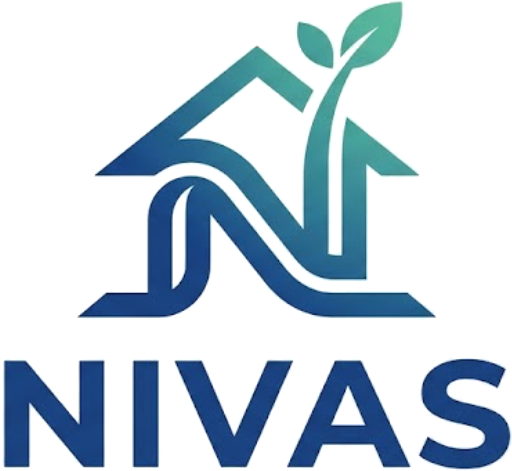

# NIVAS — Neighborhood Intelligence & Verification Analytics System

[](https://nivas-one.vercel.app)
[](./docs/development.md#backend-pytest-suite-144-tests)
[](./docs/development.md#frontend-vitest-suite-77-tests)
[](./docs/development.md#production-build-verification)
[](https://www.python.org/)
[](https://react.dev/)
[](https://fastapi.tiangolo.com/)
[](LICENSE)

<p align="center">
  
</p>

> **"Find the place that feels like home — verified by evidence, not speculation."**  
> *NIVAS is an evidence-grounded urban analytics and property due-diligence platform uniting physical defect inspection, civic infrastructure telemetry, neighborhood safety & crime intelligence, disaster hazard modeling, and legal document intelligence.*

**Live Production URL:** [https://nivas-one.vercel.app](https://nivas-one.vercel.app)  
**Canonical Repository:** [https://github.com/prastogidev/NIVAS](https://github.com/prastogidev/NIVAS)

---

## Documentation Library

Detailed documentation has been organized into dedicated guides under [`docs/`](./docs/):

- 🏛️ **[System Architecture & Data Flow](docs/architecture.md)** — Multi-service architecture, Vercel routing, and data pipelines.
- 🌳 **[Repository Structure & Git Workflow](docs/repository-structure.md)** — Directory layout, branch topology, submodule explanation, and GitHub PR banner resolution.
- 💻 **[Local Development & Testing Guide](docs/development.md)** — Setup prerequisites, running the 144 backend and 77 frontend tests, and contributing guidelines.
- 🚀 **[Deployment Guide](docs/deployment.md)** — Vercel multi-service deployment, environment matrix, preview vs production workflows, and security practices.
- 📋 **[Feature Inventory & Audit Matrix](FEATURE_INVENTORY.md)** — Granular operational status across all features.

---

## Core Workspaces

NIVAS is structured into **5 integrated, state-isolated workspaces**:

```
┌─────────────────────────────────────────────────────────────────────────────────┐
│                                NIVAS WORKSPACES                                 │
├─────────────────┬─────────────────┬─────────────────┬─────────────┬─────────────┤
│ 1. Livability   │ 2. Safety &     │ 3. Disaster     │ 4. Property │ 5. Document │
│    & Civic GIS  │    Crime Intel  │    Hazards      │    Inspect  │    Intel    │
└─────────────────┴─────────────────┴─────────────────┴─────────────┴─────────────┘
```

### 1. Neighborhood Livability Intelligence
- **Interactive Leaflet GIS**: Real-time pinpoint exploration with Nominatim forward/reverse geocoding and state persistence.
- **Civic Infrastructure Telemetry**: Concurrently queries 4 public Overpass API mirrors with failover for 13 amenity categories (schools, hospitals, public transit, emergency services, roads) with dynamic search radius (500m – 3000m) and Haversine distance calculations.
- **Environmental Context**: Live PM2.5, PM10, and AQI from Open-Meteo Air Quality API with seasonal baseline fallbacks.
- **Neighborhood AI Advisor**: Grounded conversational assistant powered by Google Gemini (via `@google/genai`), Groq, or deterministic rule engine.
- **Locality A/B Comparison**: Side-by-side comparative matrix evaluating civic density, transit accessibility, and infrastructure balance.

### 2. Safety & Crime Intelligence
- **Official Delhi Crime Grounding**: Statistical baseline grounded in official Delhi Police / NCRB compendiums.
- **Police District Boundaries**: Ray-casting point-in-polygon resolution over 15 Delhi police districts GeoJSON with explicit spatial disclosures.
- **Multi-Factor Safety Scoring**: Composite index aggregating lighting density, police post proximity, transit accessibility, and verified incident metrics.

### 3. Disaster & Environmental Hazards
- **Flood Risk Assessment**: Grounded in Delhi flood hazard zones (Yamuna floodplain, low-lying depressions, drainage proximity).
- **Seismic & Heat Risk**: BIS Seismic Zone IV classification for NCR and urban heat island (UHI) thermal proxies.
- **Cross-Locality Hazard Matrix**: Comparative hazard assessment across localities with explicit evidence tags.

### 4. Property Inspection & Risk Scoring
- **Computer Vision Defect Detection**: PyTorch EfficientNet-B0 defect classification (cracks, dampness/efflorescence, spalling, algae, clean walls) with Laplacian blur validation ($\sigma^2 \ge 50.0$) and multi-image aggregation.
- **Thermal Gradient Analysis**: MLX90640 32x24 sensor driver and 2D spatial median anomaly detection for insulation voids and moisture pockets.
- **Valuation Fairness**: Mathematical score comparing asking prices against Delhi MCD circle rate categories (A through H) with TTL disk caching.
- **Normalized Composite Score**: Dynamically re-normalizes weights (CV 30%, Thermal 20%, Location 25%, Price 25%) when specific telemetry modules are omitted.

### 5. Document Intelligence
- **Title Deed & Contract Extraction**: Structured entity, party, consideration, schedule, and registration extraction from property transaction PDFs and documents.
- **Cross-Document Discrepancy Engine**: Automated diffing across transaction chains flagging mismatches in consideration, plot dimensions, or grantor/grantee names.
- **Integrity Disclosures**: Explicit disclaimer that automated document analysis is an informational aid and does not constitute a formal legal title opinion.

---

## Quick Start for Local Development

### 1. Clone with Submodules
```bash
git clone --recurse-submodules https://github.com/prastogidev/NIVAS.git
cd NIVAS
```

### 2. Start Backend API (Port 8000)
```bash
cd backend
python3 -m venv venv
source venv/bin/activate
pip install -r requirements.txt
uvicorn main:app --reload --host 127.0.0.1 --port 8000
```
*Health check:* [http://127.0.0.1:8000/health](http://127.0.0.1:8000/health)

### 3. Start Frontend Client (Port 5173 / 3000)
```bash
# In a new terminal tab:
cd frontend
npm install
npm run dev
```

---

## Quality Assurance & Automated Testing

All automated test suites must pass cleanly:

| Test Suite | Command | Passing Tests | Status |
| :--- | :--- | :--- | :--- |
| **Backend Pytest** | `backend/venv/bin/pytest backend/tests` | **144 / 144** | `PASSED` |
| **Frontend Vitest** | `cd frontend && npm test -- --run` | **77 / 77** | `PASSED` |
| **Production Build** | `cd frontend && npm run build` | **Vite build in <1s** | `PASSED` |

---

## Git Submodule & GitHub Workflow Note

This repository uses a multi-service Git submodule structure where `backend/` tracks the `backend` branch of `prastogidev/NIVAS`.

> [!NOTE]
> **GitHub PR Banner Notice**: Whenever commits are pushed to `backend`, GitHub displays a `backend had recent pushes ... [Compare & pull request]` banner.  
> **Do NOT merge `backend` into `main`.** Merging `backend` into `main` will corrupt the repository layout and break Vercel deployments. Read [`docs/repository-structure.md`](docs/repository-structure.md) for full technical details.

---

## License & Attribution

- **License:** Licensed under the [MIT License](LICENSE).
- **Map Data:** © [OpenStreetMap](https://www.openstreetmap.org/) contributors, licensed under the Open Database License (ODbL).
- **Civic Data:** Queried via public [Overpass API](https://overpass-api.de/) mirrors.
- **Atmospheric Data:** Provided by [Open-Meteo](https://open-meteo.com/) / [OpenWeather](https://openweathermap.org/).
